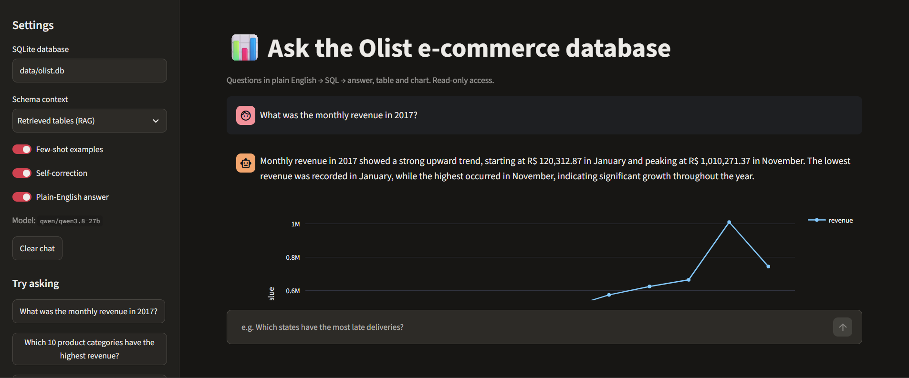
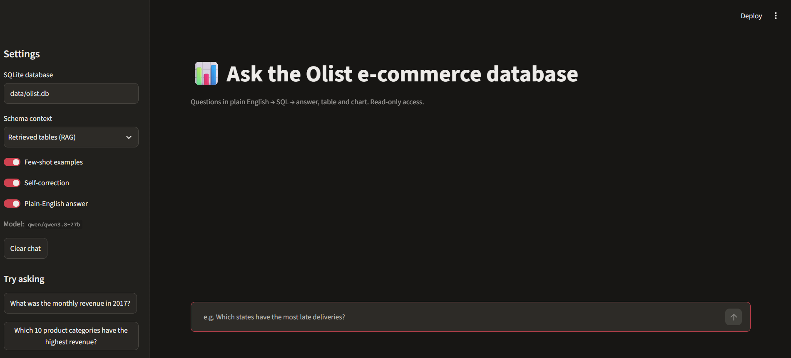
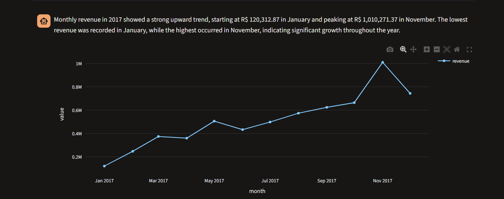
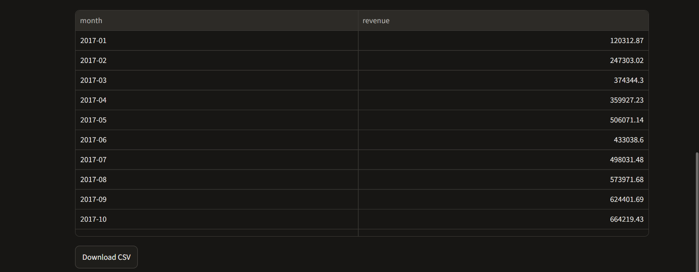
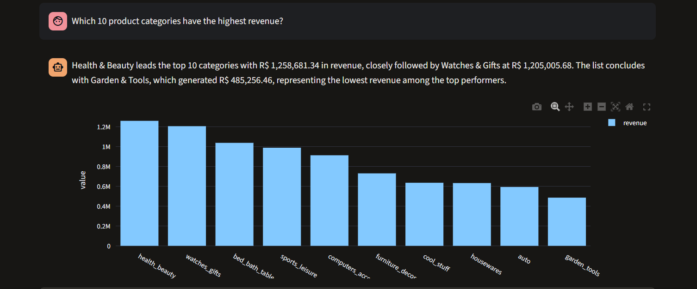
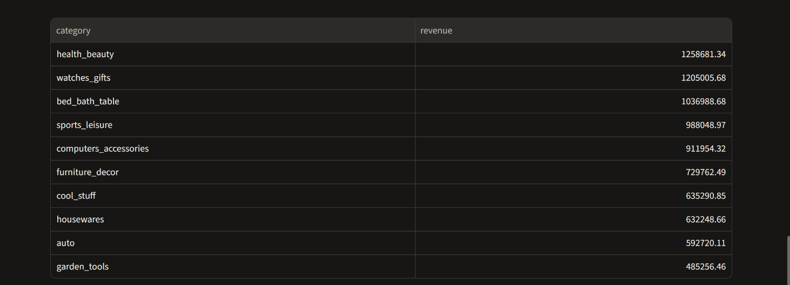
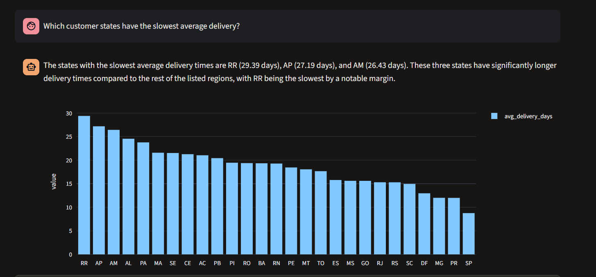
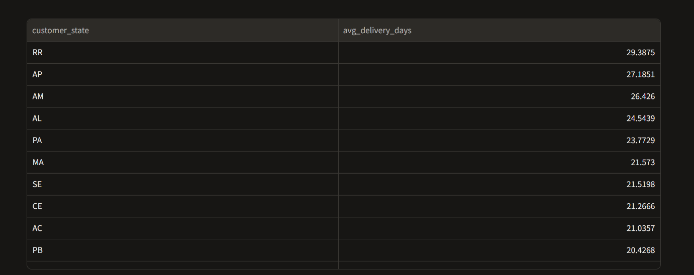
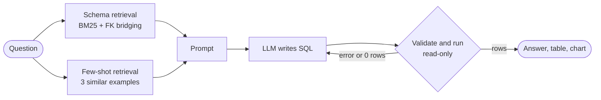

# Text-to-SQL Analytics Assistant

Ask questions about an e-commerce business in plain English. The assistant writes the SQL, runs it read-only against about 100,000 real orders, and answers with a sentence, a table and a chart.


[Features](#features) · [Screenshots](#screenshots) · [How it works](#how-it-works) · [Results](#results) · [Getting started](#getting-started) · [Evaluation](#evaluation) · [Testing](#testing) · [Project structure](#project-structure)



**Question:** *Which customer states have the slowest average delivery?*

```sql
SELECT c.customer_state,
       AVG(julianday(o.order_delivered_customer_date)
           - julianday(o.order_purchase_timestamp)) AS avg_delivery_days
FROM orders o
JOIN customers c ON c.customer_id = o.customer_id
WHERE o.order_delivered_customer_date IS NOT NULL
GROUP BY c.customer_state
ORDER BY avg_delivery_days DESC;
```

**Response:** a short plain-English answer, a bar chart of every state from slowest to fastest, the result table and a CSV download (see [Screenshots](#screenshots)).

## Features

- **Plain-English answers.** Every result comes with a short summary, an automatically chosen chart (line for time series, bar for categories), the full table and a CSV download.
- **Schema retrieval (schema RAG).** BM25 ranks the tables relevant to the question. A shortest-path search over the foreign-key graph then adds any bridge tables the joins need: for example, linking `products` to `customers` also requires `order_items` and `orders`.
- **Documented schema.** The model sees column descriptions, real example values from the data (`credit_card`, not `Credit Card`) and business rules such as "revenue = `SUM(price)`".
- **Few-shot retrieval.** The three most similar solved examples are added to each prompt.
- **Self-correction.** A failed query goes back to the model together with its error message, up to two times. An empty result triggers one check of the filter values.
- **Read-only by design.** Three independent safety layers; see [Safety](#safety).
- **Reproducible benchmark.** 52 hand-written questions with gold SQL, scored by execution accuracy, with an ablation that measures what each technique adds.
- **Works with any provider.** OpenAI, Groq, Google Gemini, OpenRouter or a local Ollama model. The HTTP client uses only the Python standard library.

## Screenshots

### Start screen

The sidebar holds the settings (database, schema context, few-shot, self-correction, plain-English answer) and example questions to try.



### Time series → line chart

*"What was the monthly revenue in 2017?"*





### Ranking → bar chart

*"Which 10 product categories have the highest revenue?"*





### Joins across tables

*"Which customer states have the slowest average delivery?"*





## How it works



| Step | What happens | Code |
|---|---|---|
| 1. Retrieve schema | BM25 over table and column descriptions selects the top 4 tables; the foreign-key graph adds bridge tables for the joins | [`schema.py`](text2sql/schema.py) |
| 2. Retrieve examples | BM25 over 20 solved question/SQL pairs selects the 3 closest | [`schema.py`](text2sql/schema.py) |
| 3. Generate | The model writes one SQLite query at temperature 0 | [`agent.py`](text2sql/agent.py), [`prompts.py`](text2sql/prompts.py) |
| 4. Validate and run | The statement is checked, then executed on a read-only connection with a timeout and a row cap | [`db.py`](text2sql/db.py) |
| 5. Self-correct | Errors (up to 2 retries) and empty results (once) are sent back to the model | [`agent.py`](text2sql/agent.py) |
| 6. Present | A rule-based chart is chosen (no LLM call), plus an optional plain-English summary | [`charts.py`](text2sql/charts.py) |

### Safety

The assistant can only read data. Each layer works independently, so a query that gets past one layer is still stopped by the next.

| Layer | Mechanism |
|---|---|
| 1. Validator | Accepts a single `SELECT` or `WITH` statement only. After stripping comments and string literals, it rejects write and admin keywords (`INSERT`, `DROP`, `ATTACH`, `PRAGMA`, ...). |
| 2. Read-only connection | SQLite is opened with `mode=ro` and `PRAGMA query_only = ON`. |
| 3. Resource limits | Queries are stopped after 15 seconds and results are capped at 5,000 rows. |

### Dataset

The [Brazilian E-Commerce Public Dataset by Olist](https://www.kaggle.com/datasets/olistbr/brazilian-ecommerce) covers orders from September 2016 to October 2018. It is loaded into eight SQLite tables with primary keys, foreign keys and indexes:

| Table | Contents |
|---|---|
| `orders` | One row per order: status and timeline (purchase, approval, carrier hand-off, delivery, estimated delivery) |
| `order_items` | One row per item: product, seller, price and freight |
| `customers` | Customer location; `customer_unique_id` identifies a person across orders |
| `payments` | Payment method, installments and amount (an order can have several) |
| `reviews` | Review score (1–5) and comments |
| `products` | Category and physical attributes |
| `sellers` | Seller location |
| `category_translation` | Portuguese to English category names |

## Results

Execution accuracy on the 52-question benchmark (18 easy, 24 medium, 10 hard):

<!-- Replace the note below with the table from eval/results/summary.md after running the benchmark. -->
> **Benchmark in progress.** The accuracy table for the five configurations will be added here. To run it yourself, see [Evaluation](#evaluation).

**Schema retrieval** needs no LLM. For all 52 questions, the retrieved tables include every table the gold query uses (100% recall), and on average only 3.8 of the 8 tables are sent.

## Getting started

### Prerequisites

- Python 3.10 or newer
- An API key for any OpenAI-compatible provider, or [Ollama](https://ollama.com) running locally

### 1. Install

```bash
git clone https://github.com/ramuverma22/text2sql-assistant.git
cd text2sql-assistant
python -m venv .venv
source .venv/bin/activate          # Windows: .venv\Scripts\activate
pip install -r requirements.txt
```

### 2. Build the database

Download the dataset from [Kaggle](https://www.kaggle.com/datasets/olistbr/brazilian-ecommerce), unzip the CSV files into `data/olist/`, then run:

```bash
python scripts/build_db.py --csv-dir data/olist --db data/olist.db
```

> **No Kaggle account?** Generate a small synthetic dataset in the same format to try the app:
>
> ```bash
> python scripts/make_demo_data.py
> python scripts/build_db.py --csv-dir data/demo_csv --db data/demo.db
> ```
>
> Then set `DB_PATH=data/demo.db`. The values are random, so don't use this database for benchmarking.

### 3. Configure the model

```bash
cp .env.example .env               # Windows: copy .env.example .env
```

Uncomment one provider block in `.env` and fill it in:

| Variable | Description |
|---|---|
| `LLM_BASE_URL` | API base URL, e.g. `https://api.openai.com/v1` |
| `LLM_API_KEY` | Your API key (any non-empty value for Ollama) |
| `LLM_MODEL` | A model name from your provider's model list |
| `DB_PATH` | The SQLite database to query (default: `data/olist.db`) |

`.env.example` has ready-made blocks for OpenAI, Groq, Google Gemini and Ollama. Groq and Gemini offer free tiers.

### 4. Run

```bash
streamlit run app.py
```

Open http://localhost:8501 and ask a question, or pick one of the examples in the sidebar. The sidebar also lets you:
- switch the schema context (retrieved tables, all documented tables, or raw `CREATE TABLE`)
- turn few-shot examples, self-correction and the plain-English answer on or off

Under each answer, expand **SQL and details** to see the generated query, every self-correction attempt, the tables in context and the token usage.

## Evaluation

[`eval/questions.json`](eval/questions.json) holds 52 hand-written questions, each with a gold SQL query. The few-shot examples in [`text2sql/examples.json`](text2sql/examples.json) are kept separate from these questions, so they don't inflate the score.

```bash
python eval/run_eval.py --db data/olist.db                               # all five configurations
python eval/run_eval.py --db data/olist.db --configs baseline full_rag   # only the two ends
python eval/run_eval.py --db data/olist.db --limit 10 --sleep 2          # quick run / free-tier rate limits
python eval/retrieval_recall.py --db data/olist.db                       # schema retrieval only, no LLM
```

**Ablation.** Each configuration adds one technique to the previous one:

| Config | Schema context | Few-shot | Self-correction |
|---|---|:---:|:---:|
| `baseline` | Raw `CREATE TABLE` statements | | |
| `docs` | All tables, documented | | |
| `docs_fewshot` | All tables, documented | ✓ | |
| `full_docs` | All tables, documented | ✓ | ✓ |
| `full_rag` | Retrieved tables only | ✓ | ✓ |

**Metric: execution accuracy.** A prediction is correct when it returns the same result as the gold query. The comparison ([`eval/compare.py`](eval/compare.py)) uses these rules:
- Row order and column order are ignored.
- Extra columns are allowed.
- Numbers are compared to 2 decimal places.
- Text is compared case-insensitively.

**Output.** Results are written to `eval/results/`:
- `summary.md`: the accuracy table
- `summary.json`
- one `<config>.jsonl` per configuration, with the SQL, errors, retries, token counts and latency for every question

## Testing

```bash
pytest -q
```

The 34 tests need no API key and no dataset. They build a small synthetic database and replace the model with scripted stand-ins. They cover:

- **SQL safety:** blocked writes and multi-statement queries, the read-only connection, the timeout and the row cap
- **Schema:** retrieval, bridge tables and example-value hints
- **Agent:** self-correction, empty-result handling and summaries
- **HTTP client:** tested against a local fake OpenAI-compatible server, including retry on HTTP 429
- **Evaluation:** result comparison rules, and the full evaluation loop end to end

## Project structure

```
├── app.py                    Streamlit chat UI
├── text2sql/
│   ├── agent.py              Pipeline: context → LLM → validate/run → self-correct → answer
│   ├── schema.py             Documented schema, BM25 table retrieval, FK bridge tables
│   ├── olist_schema.py       Tables, columns, keys, descriptions, business rules
│   ├── db.py                 Read-only execution, SQL validator, timeout, row cap
│   ├── llm.py                OpenAI-compatible client (stdlib only, retries on 429/5xx)
│   ├── prompts.py            System, error-fix and summary prompts
│   ├── charts.py             Rule-based chart selection
│   └── examples.json         20 few-shot examples, separate from the benchmark
├── eval/
│   ├── questions.json        52 benchmark questions with gold SQL
│   ├── compare.py            Result-comparison rules
│   ├── run_eval.py           Ablation runner → eval/results/
│   └── retrieval_recall.py   Schema-retrieval recall check
├── scripts/
│   ├── build_db.py           Olist CSVs → SQLite with keys and indexes
│   └── make_demo_data.py     Synthetic dataset for testing
├── tests/                    pytest suite
├── docs/                     Screenshots used in this README
└── data/                     CSV files and databases (git-ignored)
```

## Limitations and roadmap

**Limitations**
- With only 8 tables, the full schema fits in the prompt, so here schema retrieval mainly saves tokens. It matters more for schemas with hundreds of tables.
- The benchmark is small (52 questions), was written by one person and has one gold query per question. Some questions allow more than one reasonable interpretation.
- Each question is answered on its own; follow-up questions don't see earlier turns.

**Roadmap**
- Embedding-based retrieval for schema and examples
- Conversation memory for follow-up questions ("now only for SP")
- Self-consistency voting: generate several queries and keep the majority result
- PostgreSQL support

## Acknowledgements

Data: [Brazilian E-Commerce Public Dataset by Olist](https://www.kaggle.com/datasets/olistbr/brazilian-ecommerce) on Kaggle. The dataset is not included in this repository.
